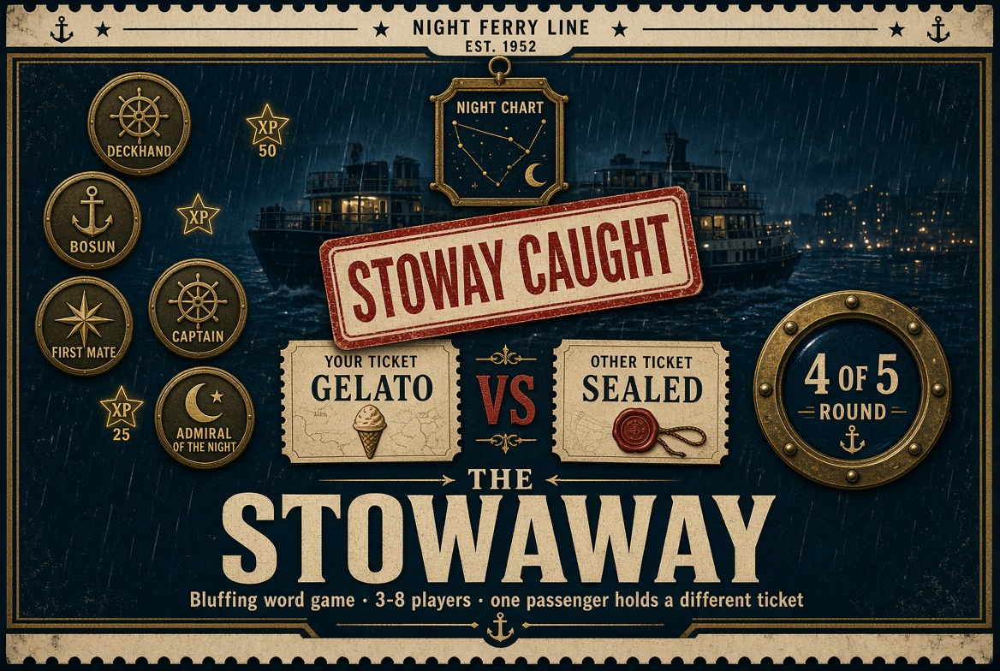

# The Stowaway: Submission

This is an entry for the Handshake AI Skills Studio "Create a Multiplayer Game" mission (OpenAI). Deadline: **Oct 30, 2026, 11:59 PM PT**.

The entry form asks for four things: a title, a cover image, a description and a link. Each one is below, ready to paste.

---

## a. Project title

```
The Stowaway: A Night Ferry Bluffing Game
```

## b. Project cover image



Upload `stoway_cover.jpg` from this folder (also saved as `covers/the-stowaway-poster.jpg`). It's a landscape poster (1168×784): the night ferry in the rain, a STOWAWAY CAUGHT stamp, your ticket against a sealed one, the Night Chart, the passenger rank medals and the round porthole.

A 1600×900 screenshot of the real reveal is also available as `covers/the-stowaway-cover.jpg`.

## c. Project description

**Short version** (use this if the form limits length):

```
Play alone right now: tap Practice. A 3–8 player bluffing word game on a rainy night ferry. Everyone holds the same destination word except one stowaway, who holds a near match and doesn't know it. Place lanterns on the Night Chart, spot whose lantern drifts, then vote the stowaway ashore. Join from any phone with a four-letter code.
```

**Full version:**

```
Play alone right now: enter a name and tap Practice, and two bot passengers board with you.

A rainy night ferry. Every passenger holds a ticket with the same secret destination word, except one: the stowaway holds a near match (Gelato instead of Sorbet) and doesn't know they're the odd one out.

How it plays:
• The Night Chart. The captain draws two scales, like Cheap ↔ Pricey and Everyday ↔ Special occasion. Everyone secretly taps where their word belongs and lights a lantern. All the lanterns appear at once, so nobody can copy. Whose sits apart from the pack?
• A second chart with two new scales. A stowaway who saw their lantern drift can try to blend in.
• Talk it over with both charts on screen, pin a suspect to make their lanterns glow, then vote. The most-voted passenger is put ashore.
• If the stowaway is caught, they get one last guess at the real word.
• The Purser's Lantern: once per voyage, privately learn whether one passenger's ticket matches yours. Everyone sees whom you checked, but not the result, so you can bluff about it.

Scoring: +100 to everyone who votes for the stowaway, +200 to a stowaway who escapes, +100 to a caught stowaway who guesses the real word.

Details:
• Join from any phone or laptop with a four-letter ticket number. No login, no install.
• Five packs (Food, Places, Movies, Everyday Objects, Mixed), 25 hand-checked pairs each, and 3, 5 or 7 rounds.
• Practice bots place lanterns from real word ratings, suspect whoever drifted, vote and guess.
• The stowaway's identity and the group word never leave the server before the reveal.
• Hold-to-reveal tickets, a porthole timer, a rubber-stamp reveal, vote tokens dropping onto the tally and a ferry horn.
• Passenger ranks from Deckhand to Admiral of the Night, eight passport stamps, a podium and a shareable result card.
```

## d. Project link

```
(add the live Render URL here after deploying)
```

Source: https://github.com/austin2-hub/The-Stowaway

---

## Quick start for a judge (about 5 minutes)

1. Open the link, type a name and tap **Practice**.
2. Hold your ticket to see your secret destination word. You might be the stowaway and not know it.
3. On the Night Chart, tap where your word belongs on the two scales and light your lantern. When all the lanterns appear, look for the one that sits apart.
4. Do the second chart, then pin a suspect and vote. See who goes ashore.
5. Try the Purser's Lantern once to check a passenger's ticket against yours.

## Before you submit

- [x] Pushed to GitHub (Oct 28).
- [ ] Deploy on Render (Build `npm install`, Start `npm start`, Health Check Path `/healthz`) and paste the URL above.
- [ ] Add an UptimeRobot monitor on the `/healthz` URL so the free instance doesn't sleep.
- [ ] Play one Night Chart crossing with 3+ real people and check the charts feel fair.
- [ ] Play one full practice game on the live link, on a phone and on a laptop.
- [ ] Paste the title, upload the cover, paste the description, and paste the link.
